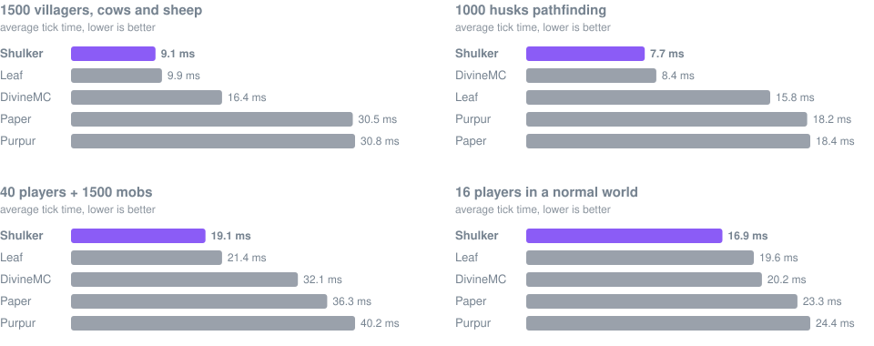
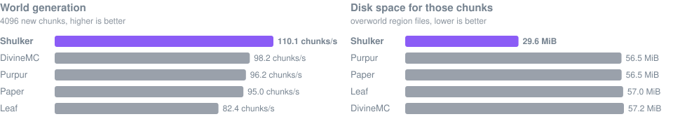

<p align="center">
  
</p>

<p align="center">
  
  
  
</p>

Shulker is a Minecraft 26.2 server built on [Paper](https://papermc.io). It runs Bukkit,
Spigot and Paper plugins, including the ones that reach into server internals, and it sets
itself up: the launcher picks the heap, the garbage collector and the CPU layout, and worlds are
stored in a compressed format that takes about half the disk space of vanilla region files.

## Performance

<p align="center">
  
</p>

<p align="center">
  
</p>

Every server was built from source for Minecraft 26.2 and run on the same machine (AMD Ryzen AI 9
365, 8 of its threads, 2 GiB heap, Java 27) with its default configuration. Shulker starts through
its own launcher; the others start with [Aikar's flags](https://docs.papermc.io/paper/aikars-flags).
The numbers are the average of two runs of [`scripts/benchmark.sh`](scripts/benchmark.sh); the
scenarios, the exact builds and the raw results are in [docs/BENCHMARKS.md](docs/BENCHMARKS.md).

## Getting started

```bash
java -jar shulker-26.2.jar nogui
```

No flag list is needed. On start the launcher looks at the machine and restarts the server with
settings that fit it:

```text
[Shulker] Profile: survival
[Shulker] Host: 8 CPUs, 30.4 GiB RAM (14.8 GiB free), bare metal
[Shulker] Java: 27 (OpenJDK 64-Bit Server VM)
[Shulker] Heap: 2.0 GiB fixed | GC: g1
[Shulker] Tick thread: CPU 0 (16 MiB L3 domain, SMT sibling kept free), other threads: CPUs 1-7
[Shulker] AOT cache: recording this run; startup gets faster after the next restart
```

| Option | |
|---|---|
| `--profile=skyblock` | pick a profile (below) |
| `--memory=8G` | cap the heap instead of sizing it from free memory |
| `--gc=zgc` | force a collector: `g1`, `zgc` or `shenandoah` |
| `--dry-run` | print the planned JVM command and exit |
| `--no-relaunch` | use exactly the flags given to `java` |

The same settings can go in `shulker-launcher.properties` or in the `SHULKER_PROFILE`,
`SHULKER_MEMORY` and `SHULKER_GC` environment variables, which is how hosting panels pass them.
Java 25 is the minimum; 26 and 27 are faster.

## Profiles

One jar serves every kind of server. A profile only shapes the configuration files the first time
they are created; after that they are yours and Shulker never rewrites them.

| Profile | Built for | Differences |
|---|---|---|
| `survival` | large worlds | vanilla distances, fixed pre-touched heap |
| `skyblock` | many small worlds | view 8, simulation 6, Alternate Current redstone, fewer spawn attempts over the void |
| `minigame` | short-lived arenas | as skyblock, cheaper armor stands |
| `lobby` | hubs | view 6, simulation 4, no Nether, static armor stands, heap capped at 6 GiB |
| `vanilla` | technical play | every exploit and dupe allowed, vanilla farm rates, no behaviour changes |

## What Shulker changes

**Launcher.** Sizes the heap from the container or panel limit, or from free memory on bare
metal. Chooses G1, generational Shenandoah or generational ZGC by heap size. Turns on compact
object headers where they are not yet the default, keeps a Leyden AOT cache for faster restarts,
and grants the JVM permissions older plugins need on new JDKs.

**Game loop.** On Linux machines with six or more cores the tick thread gets a physical core to
itself, picked by topology: a P-core on hybrid Intel CPUs, the large-cache die on dual-CCD Ryzen.
Mob pathfinding, mob sensors and entity tracking run on worker threads. POI searches, mob brains
and block collision checks do less work for the same result.

**Network.** io_uring on Linux, a limit on data queued for a client that stopped reading, and
fewer entity movement packets. Netty uses its pooled allocator and hands unflushed packets to the
connection's thread without waking it.

**World storage.** New worlds are saved as `.shulk` region files: per-chunk zstd with
dictionaries trained on Minecraft data, checksummed, recompressed harder once chunks go cold.
Existing `.mca` worlds are left alone unless `storage.format: shulk` is set, and then migrate
chunk by chunk.

```bash
java -jar shulker-26.2.jar --convert-world=world --to=shulk   # or --to=mca; with the server stopped
java -jar shulker-26.2.jar --verify-world=world               # reads back every chunk
```

Tools that read region files directly, such as BlueMap or MCA Selector, need `.mca`. The format
is documented in [docs/SHULK-FORMAT.md](docs/SHULK-FORMAT.md).

**World generation.** Leaf's density function compiler (from C2ME) is on in the performance
profiles. Every world generation change is checked with
[`scripts/worldgen-parity-test.sh`](scripts/worldgen-parity-test.sh), which generates the same seed
on a reference build and compares biomes and terrain chunk by chunk.

**Other forks.** Shulker includes the full [Leaf](https://github.com/Winds-Studio/Leaf) 26.2 patch
set, and with it the work of Purpur, Gale, Pufferfish, Leaves and Lithium, plus patches from
SparklyPaper and DivineMC. Where Shulker has its own version of a feature, that one is used. Leaf's
optimisations that keep vanilla behaviour are switched on by the profiles; the ones that change
gameplay stay off.

Parallel world ticking is available but off: `parallel-world-ticking.enabled` in `shulker.yml`.
It helps only servers with several busy worlds, and plugins that edit another world from an event
can crash the server while it is on.

## Configuration

| File | |
|---|---|
| `shulker-launcher.properties` | profile, heap, garbage collector, AOT cache, tick thread isolation |
| `shulker.yml` | storage, entity tracker, pathfinding, sensors, parallel ticking, world generation, network |
| `config/leaf-global.yml` | Leaf's optimisations |
| `config/gale-*.yml` | Gale's intervals and fixes |
| `purpur.yml` | Purpur's gameplay options |
| `config/paper-*.yml`, `spigot.yml`, `bukkit.yml` | as on Paper |

## Building

```bash
./gradlew applyAllPatches
./gradlew createShulkerJar
```

The jar is written to `build/libs/`. The build needs a Git checkout, since the server version
includes the commit hash.

| Script | |
|---|---|
| `scripts/benchmark.sh` | tick time and generation speed scenarios, for Shulker or any Paper fork |
| `scripts/fork-benchmark.sh` | the comparison above, on all servers |
| `scripts/plugin-smoke-test.sh` | boots with popular plugins and a real client login |
| `scripts/world-format-test.sh` | end-to-end `.shulk` storage, migration and conversion |
| `scripts/worldgen-parity-test.sh` | terrain comparison against a reference build |

Test servers run at low priority on eight CPUs with a 2 GiB heap (`scripts/test-env.sh`), so the
scripts can run on a desktop.

## Credits and license

Shulker is licensed under the [GNU GPL v3](LICENSE). It is built on Paper and on the forks listed
in [CREDITS.md](CREDITS.md); ported patches keep their authors and license notes.
