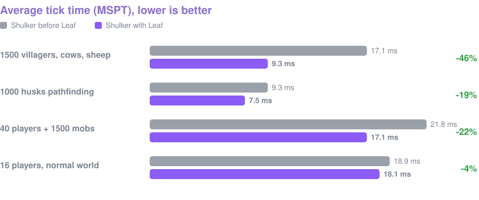
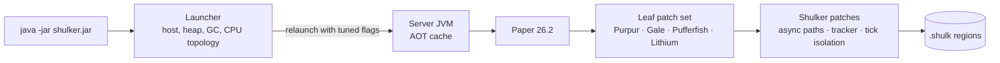

<p align="center">
  
</p>

<p align="center">
  
  
  
  
</p>

<p align="center">
  <b>Runs your Bukkit, Spigot and Paper plugins, including NMS ones like ProtocolLib and Citizens.<br>
  Picks its own JVM flags, heap and CPU layout. Stores worlds at about half the size.</b>
</p>

<p align="center">
  <a href="#-quick-start">Quick start</a> ·
  <a href="#-profiles">Profiles</a> ·
  <a href="#-performance">Performance</a> ·
  <a href="#-world-storage-shulk">World storage</a> ·
  <a href="#-configuration">Configuration</a> ·
  <a href="#-building">Building</a>
</p>

---

## ✨ Highlights

<table>
  <tr>
    <td width="33%" valign="top">
      <h3>🚀 Self-tuning launcher</h3>
      One <code>java -jar</code>, no flag lists. Shulker reads the machine and restarts itself with a
      sized heap, the right GC (G1, Shenandoah or ZGC), compact headers and a Leyden AOT cache.
    </td>
    <td width="33%" valign="top">
      <h3>🧵 CPU-aware</h3>
      The tick thread gets a physical core of its own: a P-core on hybrid Intel, the big-cache die
      on X3D Ryzen. Pathfinding and entity tracking run off the main thread.
    </td>
    <td width="33%" valign="top">
      <h3>📦 <code>.shulk</code> worlds</h3>
      Per-chunk zstd with dictionaries trained on Minecraft data: about 50% smaller than
      <code>.mca</code>, with checksums, a converter and a verifier.
    </td>
  </tr>
  <tr>
    <td width="33%" valign="top">
      <h3>🍃 Leaf inside</h3>
      The whole Leaf 26.2 patch set, which brings Purpur, Gale, Pufferfish, Leaves and Lithium
      optimisations with it.
    </td>
    <td width="33%" valign="top">
      <h3>🎛️ Profiles</h3>
      Survival, skyblock, minigame, lobby or vanilla: one jar, tuned for the server you run.
      A profile only seeds the first config, so your own edits are never overwritten.
    </td>
    <td width="33%" valign="top">
      <h3>🔌 Plugin-first</h3>
      Public Minecraft signatures are never changed, so NMS plugins keep working. Every build
      boots with LuckPerms, WorldEdit, ViaVersion, EssentialsX, PacketEvents and PlaceholderAPI.
    </td>
  </tr>
</table>

## ⚡ Quick start

```bash
java -jar shulker-26.2.jar nogui
```

That is the whole command. The launcher prints what it chose:

```text
[Shulker] Profile: survival
[Shulker] Host: 8 CPUs, 30.4 GiB RAM (14.8 GiB free), bare metal
[Shulker] Java: 27 (OpenJDK 64-Bit Server VM)
[Shulker] Heap: 2.0 GiB fixed | GC: g1
[Shulker] Tick thread: CPU 0 (16 MiB L3 domain, SMT sibling kept free), other threads: CPUs 1-7
[Shulker] AOT cache: recording this run; startup gets faster after the next restart
```

| Option | What it does |
|---|---|
| `--profile=skyblock` | pick a profile (see below) |
| `--memory=8G` | cap the heap instead of sizing it from free RAM |
| `--gc=zgc` | force a collector: `g1`, `zgc`, `shenandoah` |
| `--dry-run` | print the planned JVM command and exit |
| `--no-relaunch` | use exactly the flags you pass to `java` |

The same settings live in `shulker-launcher.properties` and in the `SHULKER_PROFILE`,
`SHULKER_MEMORY` and `SHULKER_GC` environment variables, so panels like Pterodactyl work too.

> [!NOTE]
> Java 25 is the minimum. Java 26 and 27 are faster: G1 throughput work (JEP 522), AOT caching
> with any GC (JEP 516) and compact object headers by default.

## 🎛️ Profiles

| Profile | Tuned for | JVM | Game defaults |
|---|---|---|---|
| `survival` | large worlds, throughput | fixed, pre-touched heap | vanilla view distance, Leaf optimisations on |
| `skyblock` | many small worlds | low pauses | view 8 / simulation 6, Alternate Current redstone, collision cap |
| `minigame` | short-lived arenas | low pauses | as skyblock, cheaper armor stands |
| `lobby` | hubs | heap capped at 6 GiB, shrinks when idle | view 6 / simulation 4, no nether, static armor stands |
| `vanilla` | technical play | as survival | every exploit and dupe allowed, vanilla farm rates, no behaviour changes |

## 📈 Performance

<p align="center">
  
</p>

The chart compares Shulker before and after taking Leaf's patch set, measured with
[`scripts/benchmark.sh`](scripts/benchmark.sh) on 8 CPUs and a 2 GiB heap. Shulker's own
optimisations were each measured on their own while they were added:

| Optimisation | Scenario | Result |
|---|---|---|
| POI search and Brain collections | 1500 villagers, cows, sheep | 32.5 → 21.5 ms |
| Async pathfinding | 1000 husks, unreachable targets | 24.8 → 11.3 ms |
| Multithreaded entity tracker | 40 players + 1500 mobs | 34.8 → 28.2 ms |
| Motion packet filter | 40 players + 1500 mobs | −25% network traffic |
| Parallel world ticking (opt-in) | mobs over three worlds | 20.4 → 14.5 ms |
| Tick thread isolation | 6-core machine | about −7% MSPT |

## 📦 World storage: `.shulk`

New worlds are stored as `.shulk` region files. Existing `.mca` worlds are left alone until you
set `storage.format: shulk`; they then migrate chunk by chunk as chunks are saved.

| World | `.mca` | `.shulk` | |
|---|---|---|---|
| Natively written test world | 57.6 MiB | 34.4 MiB | **−40%** |
| Converted world | 64.7 MiB | 33.0 MiB | **−49%** |

```bash
java -jar shulker-26.2.jar --convert-world=world --to=shulk   # or --to=mca; server stopped
java -jar shulker-26.2.jar --verify-world=world               # read back every chunk
```

Chunks that have not been touched for a while are recompressed at zstd level 19 in the background.
Tools that read region files directly (BlueMap, MCA Selector) need `.mca`: convert back first.
The format is described in [docs/SHULK-FORMAT.md](docs/SHULK-FORMAT.md).

## 🧭 How it fits together



<details>
<summary><b>🧵 Parallel world ticking (opt-in)</b></summary>

<br>

`parallel-world-ticking.enabled: true` in `shulker.yml` ticks each world on its own thread
(from [SparklyPaper](https://github.com/SparklyPower/SparklyPaper)). It only helps servers with
several busy worlds. Plugins that change another world from an event can crash the server, so it
is off in every profile, and a large warning is printed when it is on. While it is off, the
server behaves like Paper.

</details>

## ⚙️ Configuration

| File | Contents |
|---|---|
| `shulker-launcher.properties` | profile, heap, GC, AOT cache, tick thread isolation |
| `shulker.yml` | Shulker features: storage, entity tracker, async pathfinding, parallel ticking, network |
| `config/leaf-global.yml` | Leaf optimisations (the profile switches on the ones that keep vanilla results) |
| `config/gale-*.yml` | Gale's intervals and fixes |
| `purpur.yml` | Purpur gameplay options |
| `config/paper-*.yml`, `spigot.yml`, `bukkit.yml` | as on Paper |

Where Shulker has its own version of a Leaf feature (async pathfinding, entity tracker, parallel
ticking, io_uring, packet filters, world format), Shulker's is used and set in `shulker.yml`.
Options that change gameplay (Pufferfish's DAB, spawn throttling, the faster RNG, TT20 lag
compensation) are off in every profile.

## 🛠️ Building

```bash
./gradlew applyAllPatches
./gradlew createShulkerJar
```

The jar is written to `build/libs/shulker-<mc version>.jar`. The build needs a Git checkout,
because Paper embeds the commit hash in the server version.

| Directory | Contents |
|---|---|
| `shulker-launcher/` | the launcher (plain Java 25, no dependencies) |
| `shulker-format/` | the `.shulk` format, converter and verifier |
| `shulker-server/` | server patches on top of Paper (`minecraft-patches/`, `paper-patches/`) and Shulker's classes |
| `shulker-api/` | API patches on top of Paper API |
| `scripts/` | benchmark, plugin smoke test and world format test |

The test scripts start throwaway servers with limited resources (`scripts/test-env.sh`:
nice 10, CPUs 0–7, 2 GiB heap), so they can run on a desktop.

## 📜 Credits and license

Shulker is licensed under the [GNU GPL v3](LICENSE). It stands on
[Paper](https://github.com/PaperMC/Paper), [Leaf](https://github.com/Winds-Studio/Leaf),
[SparklyPaper](https://github.com/SparklyPower/SparklyPaper) and the many projects listed in
[CREDITS.md](CREDITS.md). Ported patches keep their original authors and license notes in the
patch header.
